# TicketFlow Service Desk

Service Desk de TicketFlow (plataforma de venta de entradas en línea) para el curso de Administración y Mantenimiento de Sistemas (ITIL v4). Los usuarios ingresan tickets y el equipo de soporte los atiende.

Monorepo:

- `backend/`: API en FastAPI con Supabase (Postgres). Tickets, comentarios, categorías, estadísticas, cálculo de prioridad y vencimientos SLA.
- `frontend/`: SPA en React + Vite. Ingreso de tickets, tablero de soporte, detalle con comentarios y estadísticas.

Para levantar todo en local: configura la base de datos, arranca el servidor del backend y luego el frontend (secciones siguientes).

## Capturas

### Nuevo ticket (usuario del servicio)

Primero se indica si quien reporta es usuario o cliente. El usuario solo ve QR rechazado en puerta, reembolso o cancelación de entrada y reenvío de ticket digital (`SERVICIOS_USUARIO` en `frontend/src/lib/constants.js`); el cliente elige el tipo y ve todo el catálogo. Impacto y urgencia vienen sugeridos según la criticidad del servicio, y la prioridad y el SLA se calculan con la matriz de la Fase 1.

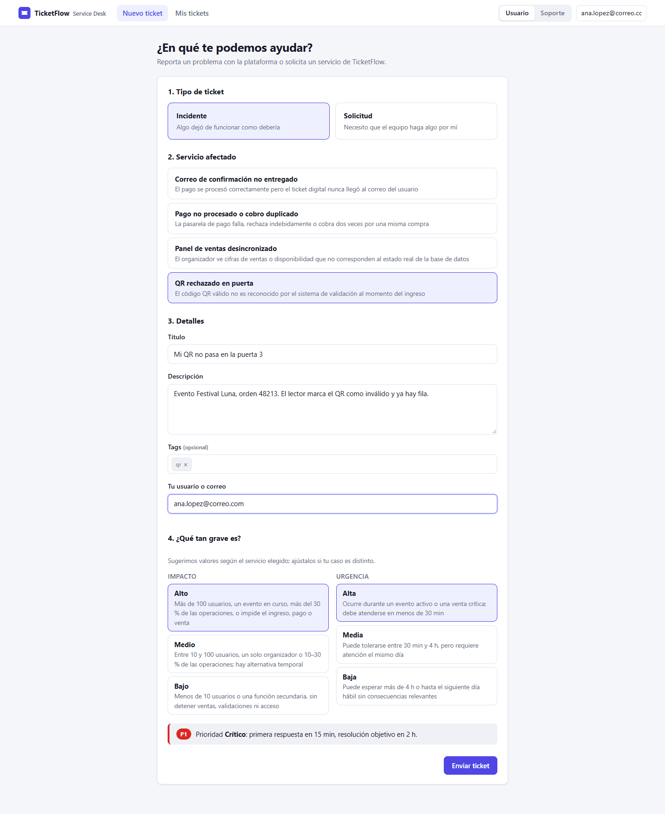

### Tablero de soporte

Cola ordenada por prioridad y antigüedad, con métricas, filtros, estado del SLA y el aviso "Escalar a N2" para los P1 que llevan más de 10 min en N1.

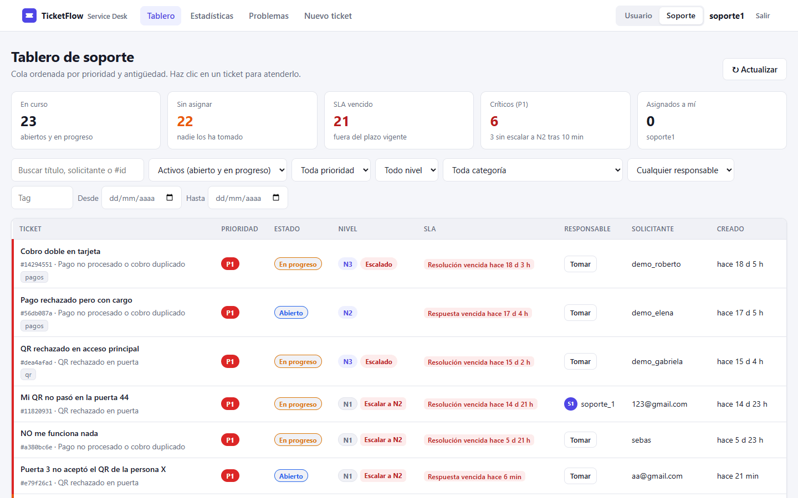

Al hacer clic en un ticket se abre el panel lateral para atenderlo sin salir del tablero.

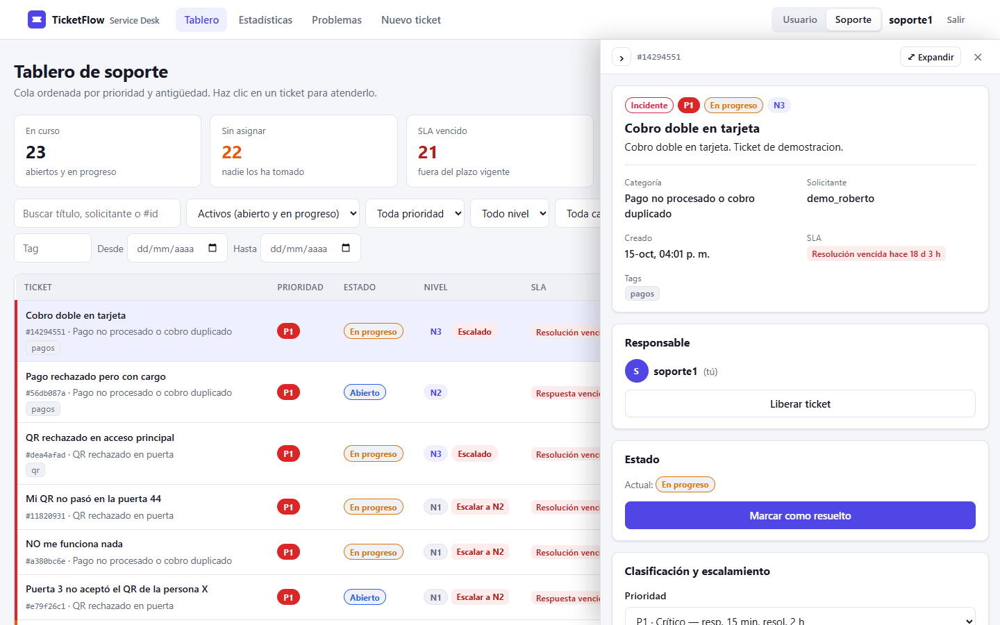

### Detalle del ticket

Vista del usuario: estado, prioridad, SLA y los comentarios de seguimiento, sin las notas internas.

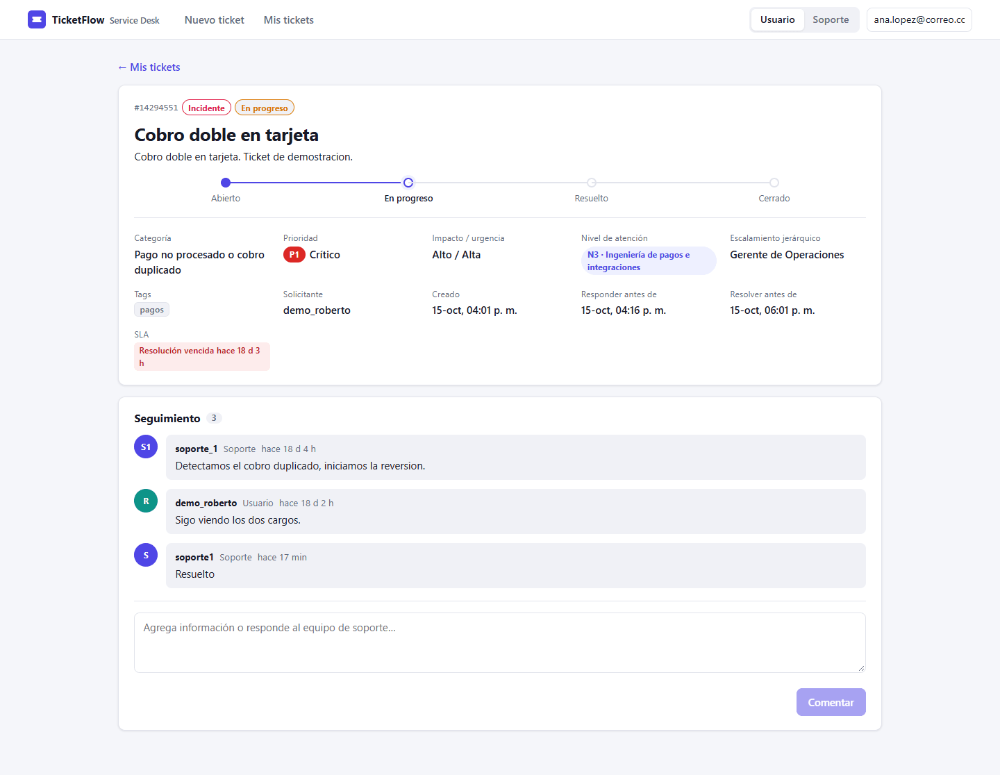

Vista de soporte: además de las notas internas, el panel para tomar el ticket, cambiar su estado, prioridad y nivel, y escalarlo.

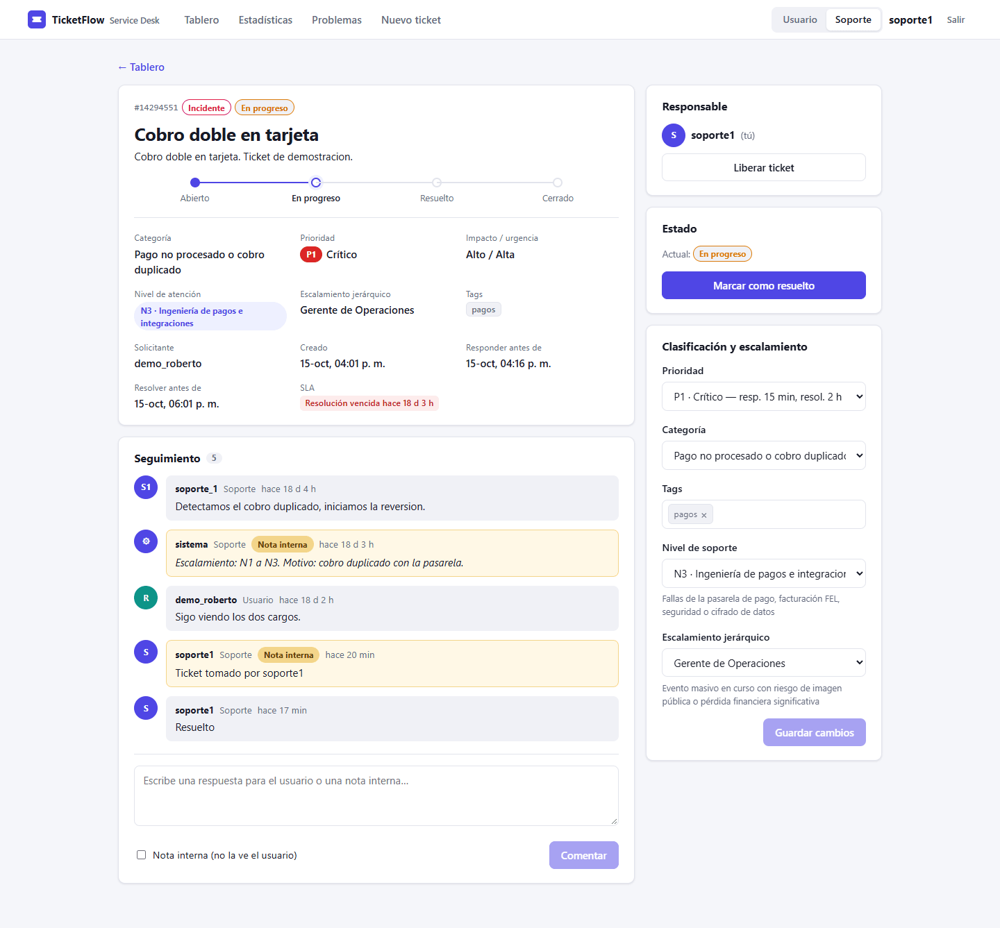

### Estadísticas

Tickets por categoría, tipo, estado, prioridad, tag y día.

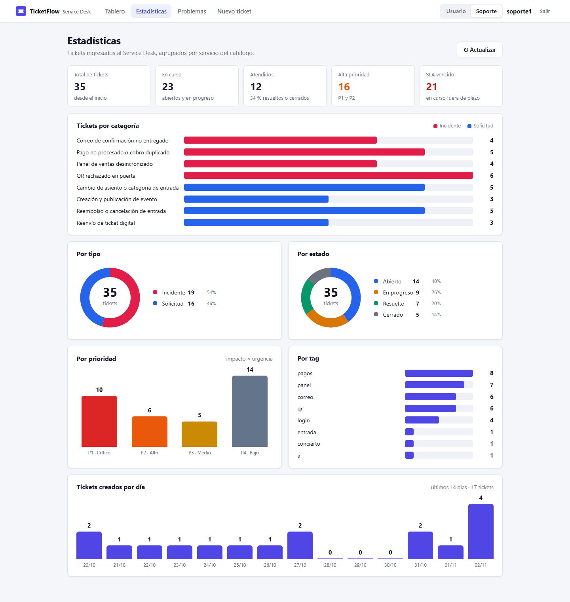

### Problemas

Causas raíz y solución temporal de cada incidente del catálogo, con el aviso para abrir un registro de problema cuando el incidente es recurrente o de alto impacto.

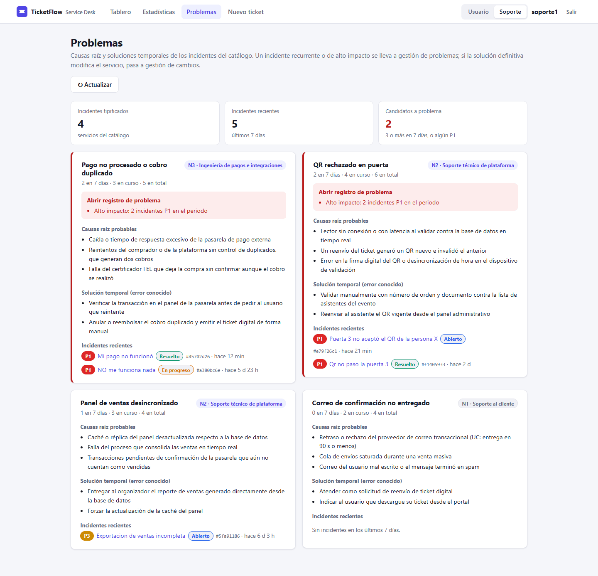

### Acceso de soporte

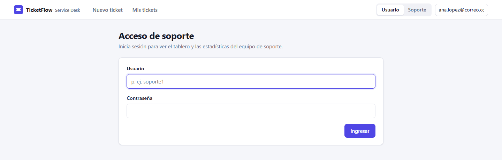

### Modo oscuro

La interfaz sigue el tema del sistema operativo.

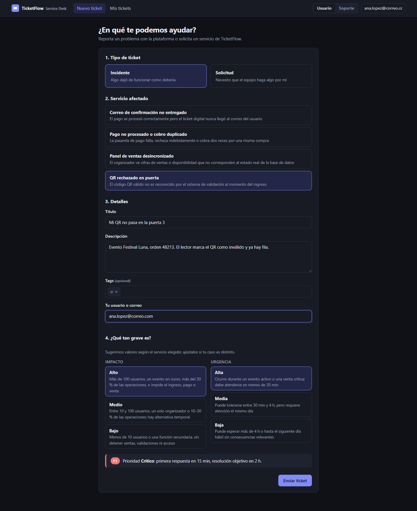

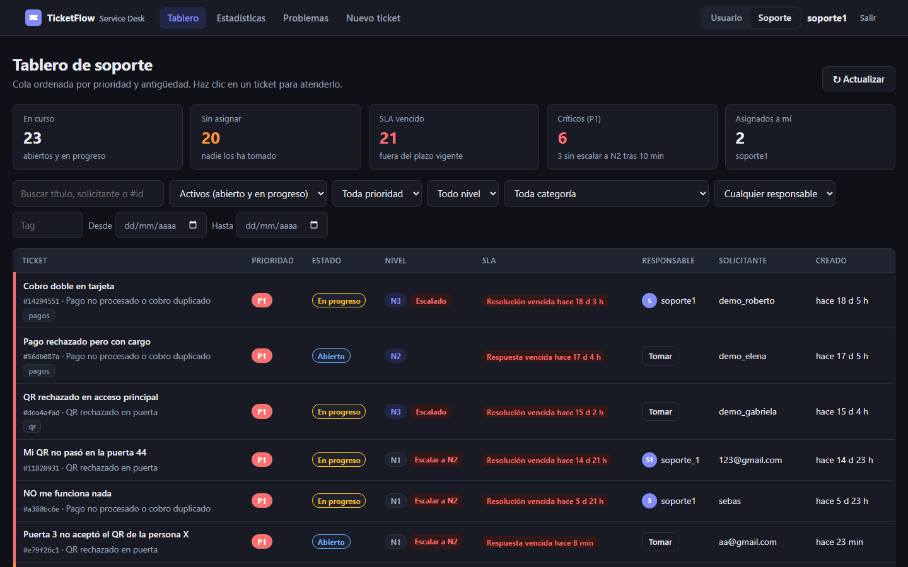

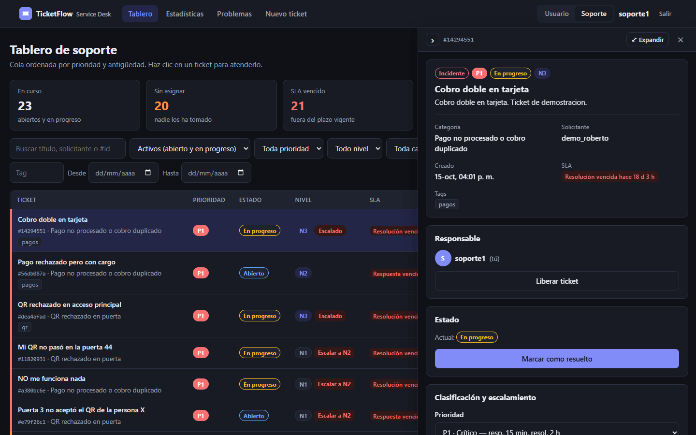

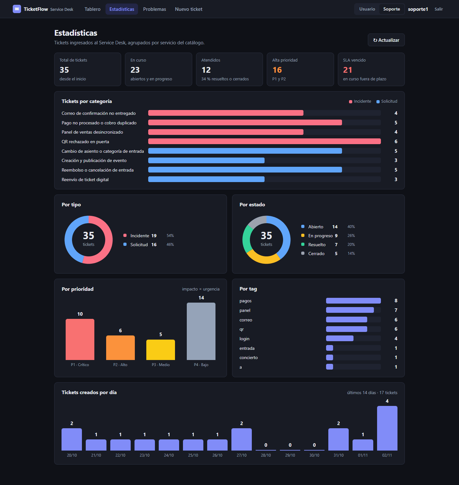

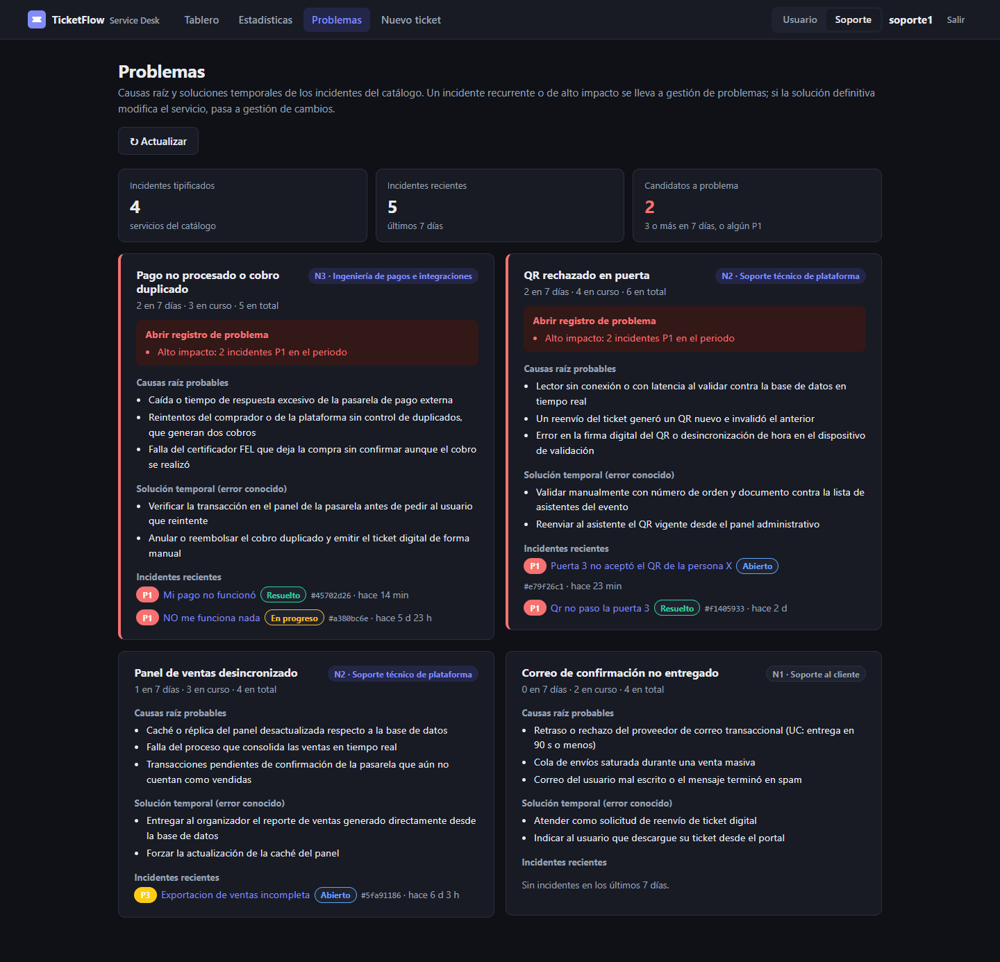

## Presentación

La presentación de la Fase 2 está en [`docs/presentacion/TicketFlow-Fase2.pptx`](docs/presentacion/TicketFlow-Fase2.pptx). Cada diapositiva tiene notas del presentador con la sección de la Fase 1 que cubre, y la de la demo incluye el guion paso a paso.

## Entorno virtual

Requiere Python 3.11 o superior.

```
cd backend
python3.11 -m venv .venv
source .venv/bin/activate
pip install -r requirements.txt
```

## Variables de entorno

```
cd backend
cp .env.example .env
```

| Variable | Descripción |
| --- | --- |
| `SUPABASE_URL` | URL de la API del proyecto, p. ej. `https://<ref>.supabase.co` (no la cadena `postgresql://`) |
| `SUPABASE_SERVICE_ROLE_KEY` | Service role key (Project Settings → API). Solo backend, nunca en el frontend |
| `CORS_ORIGINS` | Orígenes permitidos separados por comas. Por defecto `http://localhost:5173,http://localhost:3000` |
| `AUTH_SECRET` | Secreto con el que se firman los tokens de sesión (soporte y clientes). Si se deja vacío se genera uno aleatorio al arrancar y las sesiones se cierran cada vez que el servidor se reinicia. Defínelo para que persistan |
| `LOG_FILE` | Opcional. Ruta de un log NDJSON con una línea por petición (Fase 3). Vacía por defecto: sin ella la API no escribe logs. Detalle y variables relacionadas en `monitoring/README.md` |

El `.env` se lee desde el directorio donde se ejecuta el comando, así que usa siempre `backend/` como directorio de trabajo. La app arranca sin `.env`; en ese caso `/health` reporta `"supabase": false`.

## Base de datos

En el SQL editor de un proyecto Supabase vacío, ejecuta en este orden:

1. `backend/db/schema.sql`
2. `backend/db/seed.sql` (las 8 categorías)

Las tres tablas tienen RLS habilitado sin políticas: el backend usa la service role key, que ignora RLS.

## Servidor

```
cd backend
uvicorn app.main:app --reload
```

Documentación interactiva en http://localhost:8000/docs.

## Frontend

Requiere Node.js 20.19 o superior y el backend corriendo en `localhost:8000`.

```
cd frontend
npm install
npm run dev
```

Abre http://localhost:5173. Para apuntar a otro backend, crea `frontend/.env.local` con `VITE_API_URL=https://...` (el origen del frontend debe estar en `CORS_ORIGINS` del backend).

Build de producción: `npm run build` (genera `frontend/dist/`) y `npm run preview` para revisarlo.

### Vistas

El selector Usuario / Soporte del encabezado cambia de vista. El usuario que reporta un problema durante un evento no inicia sesión: escribe su nombre, que queda como solicitante y autor de sus comentarios. El cliente (promotora que contrató el servicio) inicia sesión con su cuenta al elegir "Cliente" en el formulario de nuevo ticket, y su cuenta queda fija como solicitante. Las vistas de soporte piden iniciar sesión con un usuario de soporte (ver "Sesión de soporte y de clientes"); el token se guarda en el navegador y "Salir" cierra la sesión.

| Ruta | Rol | Requerimiento | Descripción |
| --- | --- | --- | --- |
| `#/` | Ambos | 1 | Nuevo ticket: usuario o cliente, tipo, servicio del catálogo (el usuario solo ve los de evento), impacto y urgencia sugeridos según la Fase 1, y prioridad y vencimientos SLA calculados |
| `#/mis-tickets` | Usuario | 3 | Tickets creados desde este navegador y búsqueda por número |
| `#/tickets/:id` | Ambos | 3 y 4 | Detalle con comentarios de seguimiento; con sesión de soporte además se ven las notas internas y se puede editar el ticket |
| `#/soporte` | Soporte (con sesión) | 2 y 4 | Tablero: cola ordenada por prioridad y antigüedad, filtros, métricas y panel lateral para atender sin salir del tablero. Marca con "Escalar a N2" los P1 que siguen en N1 después de 10 min (OLA de la Fase 1, sección 7) |
| `#/estadisticas` | Soporte (con sesión) | 5 | Gráficas por categoría, tipo, estado, prioridad, tag y día |
| `#/problemas` | Soporte (con sesión) | Objetivo de gestión de problemas | Por cada incidente del catálogo: causas raíz probables, solución temporal (error conocido), nivel responsable e incidentes recientes. Propone abrir un registro de problema si el incidente es recurrente (3 o más en 7 días) o de alto impacto (algún P1), según la conexión Incidente → Problema de la Fase 1 |

Sin sesión, `#/soporte`, `#/estadisticas` y `#/problemas` muestran el formulario de inicio de sesión. Las causas raíz y soluciones temporales están en `PROBLEMAS_CONOCIDOS` de `frontend/src/lib/constants.js`.

El router usa el hash (`#/ruta`), así que el build se puede servir como archivos estáticos sin configurar rutas en el servidor.

## Docker

Alternativa a levantar el backend y el frontend por separado. Requiere Docker con Compose y haber configurado la base de datos y `backend/.env` (secciones anteriores).

```
docker compose up --build
```

- Backend en http://localhost:8000: imagen de Python 3.12 con uvicorn; lee las variables de `backend/.env` (si no existe arranca igual, sin Supabase).
- Frontend en http://localhost:5173: build de Vite servido con nginx.

`VITE_API_URL` se fija al construir la imagen del frontend (por defecto `http://localhost:8000`). Para otro backend: `VITE_API_URL=https://... docker compose up --build`. Define `AUTH_SECRET` en `backend/.env` para que las sesiones de soporte sobrevivan a un reinicio del contenedor.

Los datos de demostración se cargan desde el contenedor del backend:

```
docker compose exec backend python scripts/seed_demo.py --reset
```

## Monitoreo (Fase 3)

La carpeta `monitoring/` agrega Elasticsearch, Kibana, Filebeat y Heartbeat para observar esta misma API: logs de cada petición, disponibilidad y un dashboard en Kibana. Tiene su propio `docker-compose.yml` y no cambia el flujo anterior. Guía de uso en [`monitoring/README.md`](monitoring/README.md) e informe técnico en [`docs/informe-fase3.md`](docs/informe-fase3.md).

```
cd monitoring
cp .env.example .env
docker compose up -d --build
../scripts/verify-fase3.sh
```

## Pruebas

```
cd backend
pytest
```

No requieren Supabase ni `.env`: usan repositorios simulados.

Prueba de humo contra el Supabase real (única excepción; requiere `.env` con credenciales):

```
cd backend
python scripts/smoke_real.py
```

Crea tickets con solicitante `smoke_*`, verifica los endpoints y los borra al final. Sale con código distinto de cero si alguna verificación falla.

## Datos de demostración

```
cd backend
python scripts/seed_demo.py           # inserta 25 tickets con comentarios
python scripts/seed_demo.py --reset   # borra los tickets demo_* y los vuelve a insertar
```

Requiere haber ejecutado `db/seed.sql` (categorías) y tener el `.env` configurado. Todos los tickets de demostración tienen un solicitante que empieza con `demo_`; `--reset` solo borra esos (sus comentarios se eliminan en cascada). Sin `--reset`, el script no inserta si ya existen tickets demo.

## Endpoints

| Método | Ruta | Descripción |
| --- | --- | --- |
| GET | `/health` | Estado del servicio y si Supabase es alcanzable |
| POST | `/auth/login` | Inicia sesión de soporte o de cliente y devuelve un token y el `rol` de la cuenta |
| GET | `/categorias` | Las 8 categorías, ordenadas por tipo y nombre |
| POST | `/tickets` | Crea un ticket (estado `abierto`, nivel `N1`). Sin sesión solo permite los servicios de usuario (`SERVICIOS_USUARIO`); el resto exige sesión de cliente o de soporte. Con sesión de cliente el solicitante es siempre su cuenta |
| GET | `/tickets` | Lista con filtros `estado`, `prioridad`, `nivel`, `categoria_id`, `tag`. Requiere sesión de soporte |
| GET | `/tickets/{ticket_id}` | Detalle con categoría y comentarios; `rol=solicitante` (por defecto) oculta los internos. `rol=agente` requiere sesión de soporte |
| PATCH | `/tickets/{ticket_id}` | Actualiza campos, valida transiciones de estado y registra escalamientos. Requiere sesión de soporte |
| POST | `/tickets/{ticket_id}/comentarios` | Agrega un comentario (los internos solo los crea un agente). Con `autor_rol` `agente` requiere sesión de soporte |
| GET | `/estadisticas` | Conteos por categoría, tag, prioridad y estado. Requiere sesión de soporte |

Ejemplos (con el servidor en `localhost:8000`; reemplaza `$TICKET_ID` y `$CATEGORIA_ID` por UUID reales):

```
curl localhost:8000/health

curl localhost:8000/categorias

curl -X POST localhost:8000/tickets -H 'Content-Type: application/json' -d '{
  "titulo": "QR rechazado", "descripcion": "No me deja entrar",
  "categoria_id": "'$CATEGORIA_ID'", "tags": ["qr"],
  "impacto": "alto", "urgencia": "alta", "solicitante": "ana"}'

TOKEN=$(curl -s -X POST localhost:8000/auth/login -H 'Content-Type: application/json' \
  -d '{"usuario": "soporte1", "contrasena": "<contraseña>"}' | python3 -c 'import json,sys; print(json.load(sys.stdin)["token"])')

curl -H "Authorization: Bearer $TOKEN" 'localhost:8000/tickets?estado=abierto&prioridad=P1&nivel=N1&tag=qr'

curl -H "Authorization: Bearer $TOKEN" "localhost:8000/tickets/$TICKET_ID?rol=agente"

curl -X PATCH localhost:8000/tickets/$TICKET_ID -H "Authorization: Bearer $TOKEN" -H 'Content-Type: application/json' \
  -d '{"nivel": "N3", "motivo": "Requiere ingeniería"}'

curl -X POST localhost:8000/tickets/$TICKET_ID/comentarios -H "Authorization: Bearer $TOKEN" -H 'Content-Type: application/json' \
  -d '{"autor": "soporte1", "autor_rol": "agente", "contenido": "Revisando", "interno": true}'

curl -H "Authorization: Bearer $TOKEN" localhost:8000/estadisticas
```

## Contrato para el frontend

Base: `http://localhost:8000`. Cuerpos y respuestas en JSON.

### Sesión de soporte y de clientes

Hay cuatro usuarios de soporte, `soporte1` a `soporte4`, y cinco cuentas de cliente, una por promotora: `asa_promotions`, `arceyut_producciones`, `show_business_guatemala`, `promotora_2_mundos` y `epica_eventos`. Sus contraseñas se guardan hasheadas (PBKDF2-SHA256 con sal propia) en `backend/app/repositories/usuarios.py`; no existe ninguna contraseña en texto plano en el repositorio. Para cambiar una:

```
cd backend
python -c "from app.services.auth import hashear_contrasena; print(hashear_contrasena('nueva_contrasena'))"
```

y pegar el resultado en `USUARIOS_SOPORTE` o en `USUARIOS_CLIENTE`, según la cuenta.

`POST /auth/login` recibe `{"usuario": "...", "contrasena": "..."}` y responde `{"token": "...", "usuario": "...", "rol": "agente" | "cliente"}`. El token dura 8 horas y se envía en el encabezado `Authorization: Bearer <token>`. Usuario o contraseña incorrectos responden 401 con el mismo mensaje en ambos casos. El rol sale de la lista a la que pertenece la cuenta, no del token.

Exigen sesión de soporte: `GET /tickets`, `PATCH /tickets/{id}`, `GET /estadisticas`, `GET /tickets/{id}?rol=agente` y `POST /tickets/{id}/comentarios` con `autor_rol` `agente`. Una cuenta de cliente no sirve para estos endpoints. Sin token válido responden 401 `no_autenticado`.

`POST /tickets` sin sesión solo acepta los servicios de `SERVICIOS_USUARIO` (`backend/app/domain/servicios.py`, hoy `qr_rechazado_en_puerta`, `reembolso_cancelacion_entrada` y `reenvio_ticket_digital`); los demás exigen sesión de cliente o de soporte. Cuando quien crea el ticket es un cliente, el backend ignora el `solicitante` del cuerpo y guarda su cuenta. Ver categorías, ver un ticket como solicitante y comentar como solicitante siguen sin autenticación. La lista del frontend (`SERVICIOS_USUARIO` en `frontend/src/lib/constants.js`) debe coincidir con la del backend.

### Detalle del ticket y parámetro `rol`

`GET /tickets/{ticket_id}?rol=solicitante|agente` (por defecto `solicitante`).

- `solicitante`: oculta los comentarios con `interno: true`.
- `agente`: devuelve todos los comentarios.
- Los comentarios vienen ordenados por `creado_en` ascendente y el ticket incluye `categoria` completa (`nombre` y `tipo`).
- Un valor de `rol` distinto responde 422.

### PATCH y campo `motivo`

`PATCH /tickets/{ticket_id}` acepta `estado`, `prioridad`, `categoria_id`, `tags`, `nivel`, `escalamiento_jerarquico` y `motivo`. Solo se actualizan los campos enviados; un campo en `null` se trata como no enviado.

- `motivo` es opcional y no se guarda en el ticket: solo acompaña el comentario automático.
- Si cambia `nivel` o `escalamiento_jerarquico`, el backend crea un comentario interno (autor `sistema`, `autor_rol` `agente`) con el texto `Escalamiento: N1 a N3. Motivo: ...` (sin la parte del motivo si no se envía).
- Si cambia `prioridad`, los vencimientos se recalculan a partir de `creado_en`.
- Un cuerpo sin ningún campo actualizable (por ejemplo solo `motivo`) responde 422.
- Transiciones de estado permitidas: `abierto` a `en_progreso`, `en_progreso` a `resuelto`, `resuelto` a `cerrado` y `resuelto` a `en_progreso` (reapertura). `cerrado` es final. Cualquier otra, incluida la repetición del mismo estado, responde 409.

### Formato de errores

Todos los errores tienen la forma `{"detalle": ..., "codigo": ...}`.

| Estado | `codigo` | Cuándo ocurre |
| --- | --- | --- |
| 201 | (sin error) | `POST /tickets` y `POST /tickets/{id}/comentarios` crean el recurso y lo devuelven |
| 401 | `no_autenticado` | Falta el token, es inválido o expiró, la cuenta no tiene el rol que exige el endpoint, o las credenciales de `/auth/login` son incorrectas. `detalle` es un texto |
| 404 | `no_encontrado` | El ticket o la categoría no existen, o la ruta no existe. `detalle` es un texto |
| 409 | `conflicto` | Transición de estado no permitida. `detalle` es un texto, p. ej. `Transicion de estado no permitida: abierto a cerrado` |
| 422 | `validacion_error` | Valor fuera de catálogo, UUID mal formado, cuerpo vacío en PATCH, contenido vacío o comentario interno de un solicitante. `detalle` es una lista de `{campo, mensaje, tipo}` |

También usan este formato el 405 (`metodo_no_permitido`) y el 500 (`error_interno`).

### Filtros de `GET /tickets`

Todos opcionales y combinables (se aplican con AND):

| Parámetro | Valores |
| --- | --- |
| `estado` | `abierto`, `en_progreso`, `resuelto`, `cerrado` |
| `prioridad` | `P1`, `P2`, `P3`, `P4` |
| `nivel` | `N1`, `N2`, `N3` |
| `categoria_id` | UUID de una categoría |
| `tag` | Un tag; coincide si está dentro del arreglo `tags` |

Orden: prioridad ascendente con los tickets sin prioridad al final, y luego `creado_en` ascendente. Cada elemento incluye `categoria_nombre`.

### Respuesta de `/estadisticas`

```
{
  "por_categoria": [{"clave": "correo_confirmacion_no_entregado", "total": 0}, ...],
  "por_tag": [{"clave": "qr", "total": 4}, ...],
  "por_prioridad": [{"clave": "P1", "total": 2}, ..., {"clave": "sin_prioridad", "total": 1}],
  "por_estado": [{"clave": "abierto", "total": 5}, {"clave": "en_progreso", "total": 0}, ...]
}
```

- `por_categoria`: las 8 categorías (clave = `slug`), aunque tengan 0, ordenadas por tipo y nombre como `/categorias`.
- `por_estado`: los 4 estados con 0, en el orden del flujo.
- `por_prioridad`: P1 a P4 con 0; `sin_prioridad` aparece solo si hay tickets sin prioridad.
- `por_tag`: solo tags existentes, de mayor a menor total.

### Reglas de SLA

La prioridad se calcula al crear el ticket a partir de `impacto` y `urgencia`:

| Impacto \ Urgencia | alta | media | baja |
| --- | --- | --- | --- |
| alto | P1 | P2 | P3 |
| medio | P2 | P3 | P4 |
| bajo | P3 | P4 | P4 |

| Prioridad | Vence respuesta | Vence resolución |
| --- | --- | --- |
| P1 | 15 minutos | 2 horas |
| P2 | 30 minutos | 4 horas |
| P3 | 1 hora | 8 horas |
| P4 | 4 horas | 1 día hábil |
| P4 (impacto bajo × urgencia baja) | 8 horas | 2 días hábiles |

- Los plazos son los de la matriz de la Fase 1 (sección 6). Todas las celdas de una misma prioridad comparten plazos, salvo bajo × baja, que es P4 con plazos más largos.
- Los minutos y las horas son tiempo transcurrido desde `creado_en`.
- Un día hábil se calcula en la zona `America/Guatemala`: se avanza día por día contando solo de lunes a viernes, conservando la hora y sin feriados. Un P4 creado en viernes, sábado o domingo vence el lunes a la misma hora.
- `vence_respuesta_en` y `vence_resolucion_en` se guardan al crear y se recalculan si cambia la prioridad. Al recalcular se usan el impacto y la urgencia del ticket: un ticket bajo × baja que soporte pasa a P4 recibe los plazos largos.

## Estructura

```
backend/
  app/
    main.py              aplicación FastAPI y CORS
    core/config.py       configuración con pydantic-settings
    core/errors.py       formato unificado de errores
    core/access_log.py   middleware que escribe el log NDJSON de cada petición (Fase 3)
    domain/enums.py      valores fijos del dominio
    db/client.py         cliente Supabase perezoso
    repositories/        único acceso a datos
    schemas/             modelos Pydantic
    services/            lógica de negocio (prioridad, sla, tickets, auth)
    api/routers/         endpoints
  db/                    schema.sql y seed.sql
  scripts/seed_demo.py   datos de demostración
  scripts/smoke_real.py  prueba de humo contra Supabase real
  scripts/limpiar_trafico.py  lista o borra los tickets del generador de tráfico (Fase 3)
  tests/                 pruebas con repositorios simulados
  Dockerfile             imagen del backend
frontend/
  src/
    main.jsx             punto de entrada
    App.jsx              rutas
    pages/               una vista por ruta
    components/          encabezado, panel de ticket, gráficas y componentes compartidos
    lib/api.js           cliente del backend
    lib/constants.js     valores del dominio y criterios de la Fase 1
    lib/router.jsx       router por hash
    lib/session.jsx      rol, nombre y sesión (soporte o cliente)
    styles.css           estilos
docker/                  Dockerfile del frontend
docker-compose.yml       backend y frontend con Docker
monitoring/              ELK, Heartbeat, generador de tráfico y dashboard (Fase 3)
scripts/                 importar-dashboard.sh y verify-fase3.sh
docs/informe-fase3.md    informe técnico de la Fase 3
```
