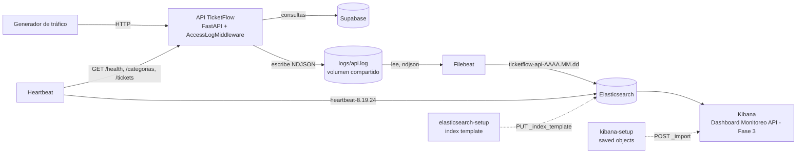
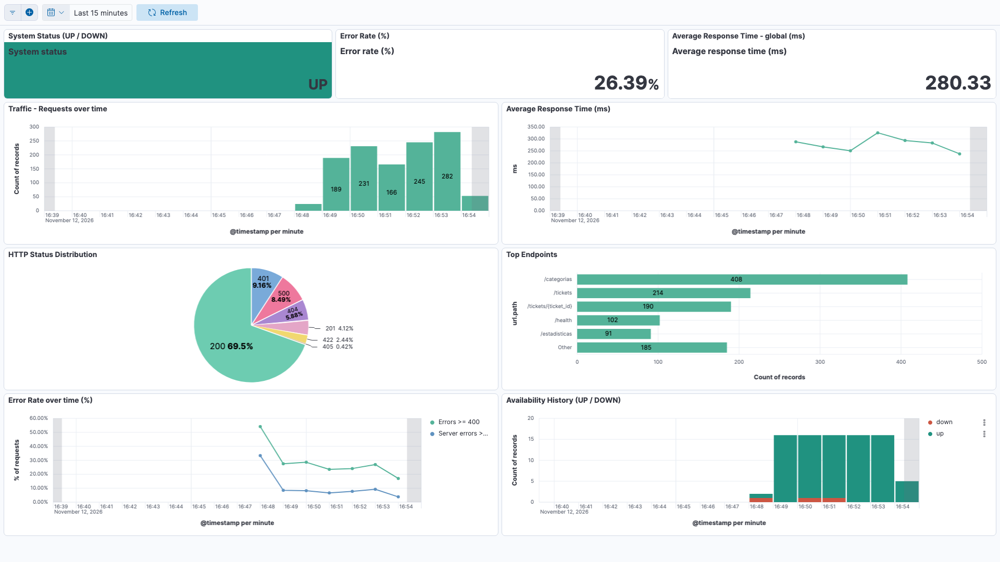
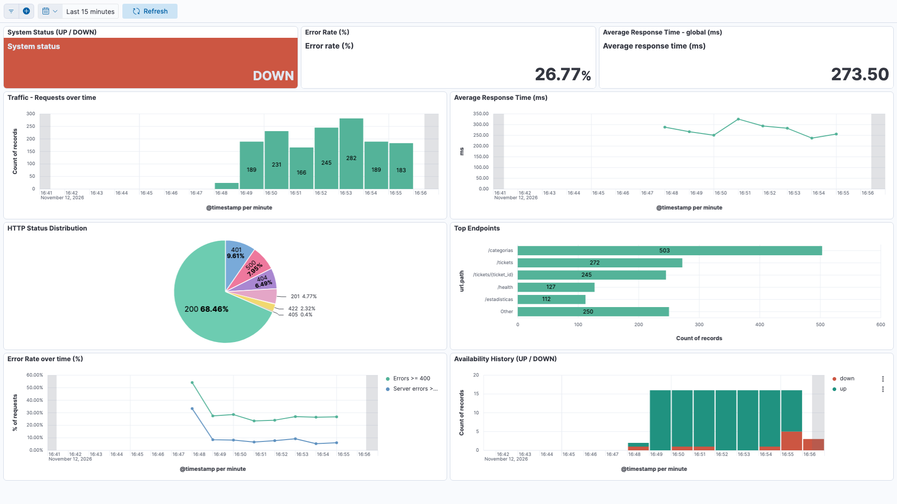
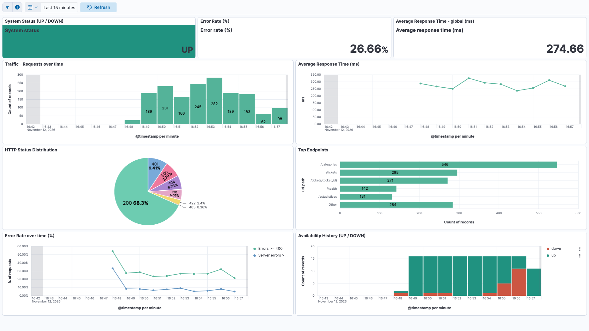
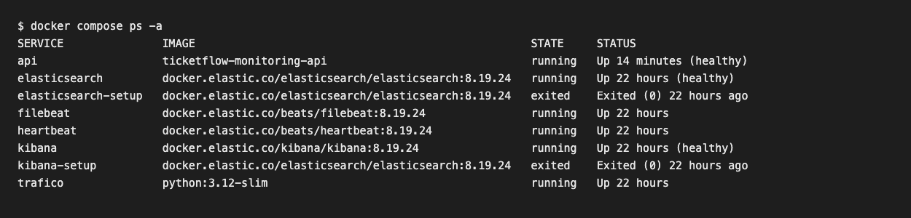
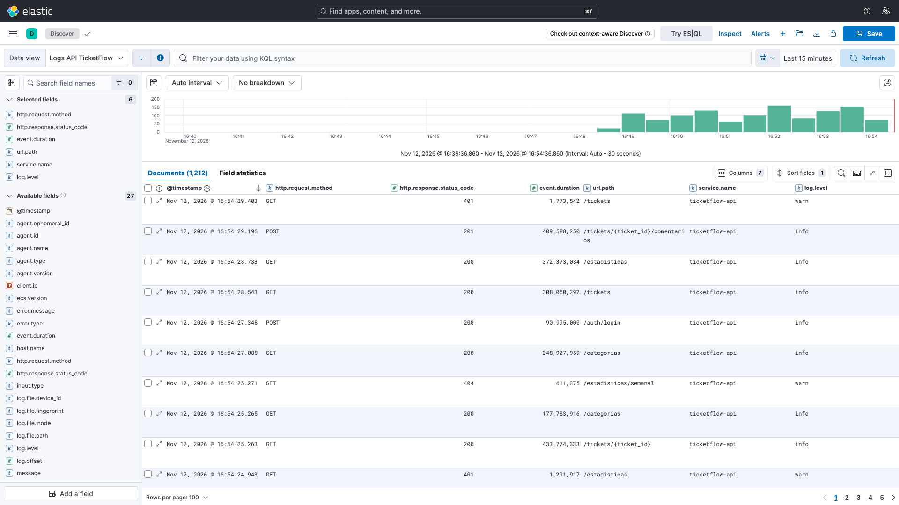
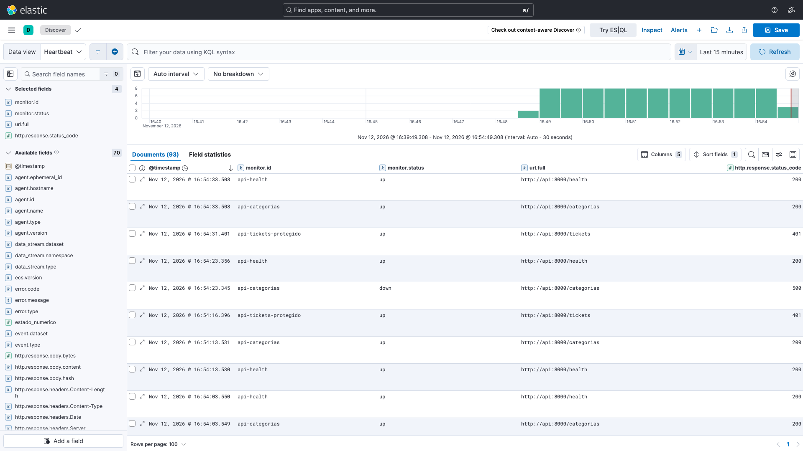

# Informe técnico - Fase 3: Monitoreo con ELK

CC3047 Administración y Mantenimiento de Sistemas, UVG, semestre II 2026.
Sistema monitoreado: TicketFlow Service Desk (Fases 1 y 2).

## 1. Introducción

Esta fase agrega observabilidad a TicketFlow: cada petición que recibe la API queda registrada de forma estructurada, esos registros llegan a Elasticsearch, un monitor de Heartbeat verifica la disponibilidad de los endpoints y un dashboard de Kibana muestra en tiempo real el tráfico, la latencia, los códigos HTTP, la tasa de errores y el estado del sistema.

Todo el código y la configuración de la fase están en `monitoring/` (compose, Filebeat, Heartbeat, plantilla de índice, dashboard y generador de tráfico), más el middleware de la API en `backend/app/core/access_log.py`, los scripts de `scripts/` y este informe. La guía de uso está en [`monitoring/README.md`](../monitoring/README.md).

## 2. Vía elegida y justificación

Se eligió la **vía de API propia**: se instrumenta la API real de TicketFlow (FastAPI, Fase 2), que ya implementa el servicio definido en la Fase 1 (catálogo de 8 servicios: 4 solicitudes y 4 incidentes). Es la vía que cumple de forma directa el criterio de la rúbrica de que los logs provengan de las APIs del servicio definido en la Fase 1, sin construir una simulación.

Consecuencias de esa elección:

- Las condiciones adicionales de la API simulada (un endpoint por servicio del catálogo, proporción de errores y latencias artificiales) no aplican. En TicketFlow los servicios del catálogo no son endpoints: son filas de `categorias` que se consultan con `GET /categorias` y se usan al crear tickets con `POST /tickets`. El generador de tráfico crea tickets de todas las categorías.
- La latencia variable es natural: cada petición hace una o más consultas al Supabase real. El único comportamiento artificial es la inyección opcional de errores 500, descrita en la sección 5, necesaria porque la API casi nunca devuelve 5xx por sí sola.
- Como la API usa el Supabase real, el generador crea tickets reales. Se marcan con la etiqueta `trafico_auto` y un título que empieza con `[trafico] `, y `backend/scripts/limpiar_trafico.py` los lista o borra.

## 3. Arquitectura



| Componente | Imagen / tecnología | Función |
| --- | --- | --- |
| `api` | `backend/Dockerfile` (Python 3.12, FastAPI) | Sirve la API y escribe un registro JSON por petición |
| `filebeat` | `docker.elastic.co/beats/filebeat:8.19.24` | Lee `api.log` y lo envía a Elasticsearch |
| `elasticsearch` | `docker.elastic.co/elasticsearch/elasticsearch:8.19.24` | Almacena logs y resultados de Heartbeat |
| `elasticsearch-setup` | misma imagen de Elasticsearch | Un solo uso: carga el index template y termina |
| `kibana` | `docker.elastic.co/kibana/kibana:8.19.24` | Visualización |
| `kibana-setup` | misma imagen de Elasticsearch | Un solo uso: importa el dashboard y termina |
| `heartbeat` | `docker.elastic.co/beats/heartbeat:8.19.24` | Verifica la disponibilidad de la API |
| `trafico` | `python:3.12-slim` (perfil `trafico`) | Ejecuta el generador de tráfico |

Las cuatro imágenes de Elastic usan la misma versión fija, 8.19.24 (la más reciente de la serie 8.x publicada para las cuatro en el momento de la entrega); no se usa `latest`.

## 4. Endpoints de la API

Los registros cubren todos los endpoints de la API.

| Método | Ruta | Acceso |
| --- | --- | --- |
| GET | `/health` | público (también lo usa Heartbeat) |
| POST | `/auth/login` | público |
| GET | `/categorias` | público |
| POST | `/tickets` | público para los servicios de usuario; sesión de cliente o soporte para el resto |
| GET | `/tickets` | soporte |
| GET | `/tickets/{ticket_id}` | público para el solicitante; soporte con `rol=agente` |
| PATCH | `/tickets/{ticket_id}` | soporte |
| POST | `/tickets/{ticket_id}/comentarios` | público para el solicitante; soporte para agente |
| GET | `/estadisticas` | soporte |

## 5. Proporción de errores, latencia y registro

### Proporción de errores configurada

| Parámetro | Valor | Efecto |
| --- | --- | --- |
| `TRAFICO_PROPORCION_ERROR` | `0.2` | El generador elige el grupo de errores del cliente para el 20 % de sus peticiones (rutas inexistentes, sin sesión, payload inválido, id inexistente o malformado, transición inválida, método no permitido, credenciales incorrectas) |
| `FALLOS_PORCENTAJE` | `8` | La API responde 500 al 8 % de las peticiones que llevan la cabecera `X-Simular-Fallos`, que solo envía el generador. `/health` y Heartbeat quedan fuera |

Resultado medido en la corrida de la sección 8 (1700 documentos, 04:06 a 04:15 UTC):

| Clase | Documentos | Porcentaje |
| --- | --- | --- |
| 2xx | 1292 | 76,0 % |
| 4xx | 301 | 17,7 % |
| 5xx | 107 | 6,3 % |

El porcentaje de 5xx medido es menor al 8 % configurado porque (a) la cifra de 1700 incluye las peticiones de Heartbeat y `/health`, que nunca reciben fallos inyectados, y (b) 102 de los 107 son inyectados y 5 son reales (sección 9, problema 8). Sobre el tráfico del generador a rutas distintas de `/health`, los fallos inyectados midieron 7,2 % en una medición posterior de la misma corrida.

### Latencia

No se simula: viene de la ejecución real. En la misma corrida `event.duration` tuvo 1700 valores distintos: mínimo 0,12 ms (rechazos 401/404 sin consulta), promedio 229,92 ms, mediana 178,71 ms, p95 525,40 ms, p99 732,92 ms y máximo 1170,73 ms.

### Registro

`AccessLogMiddleware` (middleware ASGI, `backend/app/core/access_log.py`) escribe una línea JSON por petición en `LOG_FILE`. Solo se instala si `LOG_FILE` está definida, de modo que sin ella la API se comporta como en la Fase 2.

| Campo | Contenido |
| --- | --- |
| `@timestamp` | Instante en que termina la petición, ISO 8601 UTC con milisegundos (`2026-11-10T04:07:02.126Z`) |
| `http.request.method` | Método HTTP |
| `http.response.status_code` | Código de la respuesta (numérico) |
| `event.duration` | Duración en **nanosegundos** (`time.perf_counter_ns`) |
| `url.path` | Plantilla de la ruta (`/tickets/{ticket_id}`), no la ruta con el UUID |
| `service.name` | `ticketflow-api` (variable `SERVICE_NAME`) |
| `log.level` | `info` para 2xx y 3xx, `warn` para 4xx, `error` para 5xx |
| Extras | `message`, `url.original` (ruta real con query), `trace.id` (también en la cabecera `X-Request-ID`), `client.ip`, `user_agent.original`, y `error.type` y `error.message` en los fallos |

Decisión: `url.path` lleva la plantilla para que "Top Endpoints" agrupe por endpoint en lugar de crear una entrada por cada UUID; la ruta real queda en `url.original`. Si la ruta no existe, se registra la ruta pedida.

El archivo rota por tamaño (`RotatingFileHandler`, 5 MB por archivo, 3 respaldos).

## 6. Configuración de cada componente

### docker-compose.yml

Se eligió un compose propio en `monitoring/` en lugar de ampliar el de la aplicación: `docker compose up` normal no levanta cuatro servicios de Elastic y el compose de la Fase 2 queda intacto. Con la pila completa en marcha, `docker stats` midió cerca de 1,5 GB de memoria en uso (Elasticsearch 873 MiB, Kibana 403 MiB, API 106 MiB, Heartbeat 68 MiB, Filebeat 56 MiB, generador 25 MiB), con 8 GB asignados a Docker.

- Elasticsearch: un nodo (`discovery.type=single-node`), seguridad deshabilitada, heap de 512 MB, volumen persistente `esdata`.
- Healthchecks en Elasticsearch (`_cluster/health?wait_for_status=yellow`), Kibana (`/api/status` disponible) y la API (conexión al puerto 8000, sin generar una línea de log por cada chequeo).
- `filebeat` depende de `elasticsearch` sano y de que `elasticsearch-setup` termine bien. `heartbeat` depende de `elasticsearch` sano y de `api` sana. `kibana-setup` depende de Kibana sano.
- Red `monitoring` compartida: Heartbeat alcanza la API por el nombre `api`.
- Permisos de `filebeat.yml` y `heartbeat.yml`, montados desde el host: ambos servicios corren con `user: root` y el argumento `--strict.perms=false`. Los dos arrancan y se mantienen `running` (sección 8).
- El generador es un servicio opcional bajo el perfil `trafico`.

### Filebeat (`monitoring/filebeat/filebeat.yml`)

- Input `filestream` sobre `/var/log/ticketflow/api.log`, con identidad de archivo por huella (`file_identity.fingerprint`) para no depender del inode en el volumen compartido.
- Parser `ndjson` con `target: ""`, `overwrite_keys`, `expand_keys` y `add_error_key`: los campos llegan estructurados y `@timestamp` se toma de la línea, no del momento de lectura.
- Salida al índice explícito `ticketflow-api-%{+yyyy.MM.dd}`. `setup.ilm.enabled` y `setup.template.enabled` están en `false` porque el template lo carga `elasticsearch-setup`; `setup.template.name` y `pattern` se conservan coherentes con el nombre del índice.

### Index template (`monitoring/elasticsearch/ticketflow-api-template.json`)

Mapeos explícitos: `@timestamp` date; `event.duration` y `http.response.status_code` long; `http.request.method`, `url.path`, `url.original`, `service.name`, `log.level`, `trace.id` y `user_agent.original` keyword; `client.ip` ip. Un shard y cero réplicas.

### Heartbeat (`monitoring/heartbeat/heartbeat.yml`)

| Monitor | URL | Intervalo | Condición de "up" |
| --- | --- | --- | --- |
| `api-health` | `http://api:8000/health` | 10 s | estado 200 y cuerpo con `"status":"ok"` |
| `api-categorias` | `http://api:8000/categorias` | 10 s | estado 200 y cuerpo con `qr_rechazado_en_puerta` |
| `api-tickets-protegido` | `http://api:8000/tickets` | 15 s | estado 401 (la ruta protegida responde y exige sesión) |

Timeout de 5 s en los tres. Los resultados van a `heartbeat-8.19.24` (data stream por defecto de Heartbeat, cubierto por el patrón `heartbeat-*`).

### Generador de tráfico (`monitoring/trafico/generar_trafico.py`)

Solo usa la biblioteca estándar de Python 3, de modo que corre igual en el host y en el contenedor. Parámetros: URL base, peticiones por segundo, duración (o infinito), proporción de errores, hilos, tope de tickets creados, `timeout`, semilla y modo solo lectura (cada uno con su variable `TRAFICO_*`).

- Ritmo variable: llegadas con distribución exponencial, modulación senoidal (periodo de 90 s) y ráfagas ocasionales al doble.
- Escenarios válidos: listar categorías, `/health`, listados filtrados, estadísticas, detalle público y de agente, login de soporte y de cliente, creación de tickets como usuario y como cliente, avance de estado y escalamiento por PATCH, comentarios públicos e internos.
- Escenarios de error: ruta inexistente, `/tickets` y `/estadisticas` sin token, login incorrecto, payload inválido (422), ticket inexistente (404), id malformado (422), transición inválida (409), `DELETE /categorias` (405), PATCH sin token y servicio restringido sin sesión (401).
- Solo modifica tickets que él mismo creó (PATCH y comentarios), y crea como máximo `TRAFICO_MAX_CREACIONES` por ejecución.

### Kibana

El dashboard se guarda como saved objects en `monitoring/kibana/dashboard.ndjson` (2 data views, 9 visualizaciones Lens y el dashboard). `kibana-setup` lo importa al levantar y `scripts/importar-dashboard.sh` permite repetirlo. Dashboard "Monitoreo API - Fase 3": rango por defecto de 15 minutos y refresco de 5 segundos, guardados con el dashboard.

## 7. Visualizaciones

Las seis visualizaciones mínimas, más tres complementarias. Data view de logs: `ticketflow-api-*`; de Heartbeat: `heartbeat-*`; ambos con `@timestamp`.

| Panel | Tipo | Campos y consulta |
| --- | --- | --- |
| G1 `Traffic - Requests over time` | Barras verticales | Eje X: `@timestamp` cada 1 minuto (título "@timestamp per minute"). Eje Y: Count of records. Con etiquetas de valor |
| G2 `Top Endpoints` | Barras horizontales | Top 5 values de `url.path` con "Other" activado, orden descendente por Count of records. Con etiquetas de valor |
| G3 `HTTP Status Distribution` | Gráfico circular | Slice by: Top 10 values de `http.response.status_code`. Size by: Count of records. Etiquetas con código y porcentaje |
| G4 `Average Response Time (ms)` | Líneas | Eje X: `@timestamp` cada 1 minuto. Eje Y: fórmula `average(event.duration) / 1000000`, 2 decimales, título "ms" |
| G5 `System Status (UP / DOWN)` | Metric | Último valor del estado de `api-health` (filtro `monitor.id : "api-health"`): verde UP, rojo DOWN |
| G5 `Availability History (UP / DOWN)` | Barras apiladas | `@timestamp` por minuto, Count of records, desglose por `monitor.status` (up verde, down rojo) |
| G6 `Error Rate (%)` | Metric | `count(kql='http.response.status_code >= 400') / count()`, formato porcentaje |
| G6 `Error Rate over time (%)` | Líneas, dos series | `>= 400` (errores totales) y `>= 500` (errores de servidor), cada una dividida entre `count()`, por minuto |
| Complementario `Average Response Time - global (ms)` | Metric | `average(event.duration) / 1000000` |

Definiciones: **tasa de errores totales** = peticiones con `http.response.status_code >= 400` entre todas las peticiones del rango; **tasa de errores de servidor** = las de `>= 500` entre todas las peticiones del rango.

Nota sobre G5: Lens solo permite color dinámico en métricas numéricas y `monitor.status` es texto. El Metric usa un campo calculado del data view de Heartbeat, `estado_numerico` (1 si `monitor.status` es `up`, 0 en otro caso), con formato "static lookup" (1 se muestra UP, 0 se muestra DOWN) y una paleta de dos colores. El valor sigue derivándose de `monitor.status` del último documento de `api-health`.

Distribución, de arriba hacia abajo: fila 1, estado, error rate y latencia global; fila 2, G1 y G4; fila 3, G3 y G2; fila 4, error rate en el tiempo e historial up/down. Con una ventana de 1920 x 1080 en modo pantalla completa caben los cuatro renglones sin desplazarse.

## 8. Resultados

Todas las salidas son de una corrida desde cero (`docker compose down -v`, luego `docker compose up -d --build`) el 10 de noviembre de 2026. Kibana muestra la hora local del navegador (UTC-6): 22:07 equivale a 04:07 UTC.

### Arranque sin pasos manuales

```
tiempo hasta kibana healthy y dashboard importado: 42 s

$ docker compose ps -a
SERVICE               STATE     STATUS
api                   running   Up 4 minutes (healthy)
elasticsearch         running   Up 10 minutes (healthy)
elasticsearch-setup   exited    Exited (0) 10 minutes ago
filebeat              running   Up 10 minutes
heartbeat             running   Up 10 minutes
kibana                running   Up 10 minutes (healthy)
kibana-setup          exited    Exited (0) 9 minutes ago
trafico               running   Up 9 minutes
```

### Índices y documentos

```
$ curl -s 'localhost:9200/_cat/indices/ticketflow-api-*,*heartbeat-*?v&h=index,health,docs.count,store.size'
index                                   health docs.count store.size
ticketflow-api-2026.11.10               green        1700        1mb
.ds-heartbeat-8.19.24-2026.11.10-000001 green         163    559.4kb

$ curl -s 'localhost:9200/ticketflow-api-*/_search?size=2&sort=@timestamp:desc&_source=@timestamp,http.request.method,http.response.status_code,event.duration,url.path,service.name,log.level'
{"@timestamp": "2026-11-10T04:15:41.229Z", "event": {"duration": 306474459}, "http": {"request": {"method": "GET"}, "response": {"status_code": 200}}, "log": {"level": "info"}, "service": {"name": "ticketflow-api"}, "url": {"path": "/tickets/{ticket_id}"}}
{"@timestamp": "2026-11-10T04:15:41.209Z", "event": {"duration": 1991875}, "http": {"request": {"method": "GET"}, "response": {"status_code": 422}}, "log": {"level": "warn"}, "service": {"name": "ticketflow-api"}, "url": {"path": "/tickets/{ticket_id}"}}
```

### Mapeos

```
$ curl -s 'localhost:9200/ticketflow-api-*/_mapping/field/@timestamp,event.duration,http.response.status_code,http.request.method,url.path,service.name,log.level'
@timestamp -> date
event.duration -> long
http.request.method -> keyword
http.response.status_code -> long
log.level -> keyword
service.name -> keyword
url.path -> keyword
```

### Distribución de códigos y rutas

```
total: 1700
codigos: 200=1149, 201=143, 401=137, 500=107, 404=86, 422=46, 409=23, 405=9
2xx: 1292 (76.0%)
4xx: 301 (17.7%)
5xx: 107 (6.3%)

url.path distintos: 15
     415  /tickets/{ticket_id}
     385  /categorias
     367  /tickets
     161  /health
     113  /estadisticas
      96  /auth/login
      96  /tickets/{ticket_id}/comentarios
      (8 rutas inexistentes del grupo de errores, entre 6 y 11 peticiones cada una)

event.duration valores distintos: 1700
min=0.12 ms  avg=229.92 ms  max=1170.73 ms  desv=174.88 ms
p50=178.71 ms  p95=525.40 ms  p99=732.92 ms
```

### Prueba del caso DOWN

```
parada api: 2026-11-10T04:10:02Z
$ docker compose stop api
 Container ticketflow-monitoring-api-1 Stopped
```

Con la API detenida, Heartbeat reportó `down` en los tres monitores (14 documentos en los 65 segundos siguientes a la medición):

```
DOWN 2026-11-10T04:10:50.172Z api-tickets-protegido down | lookup api on 127.0.0.11:53: no such host
DOWN 2026-11-10T04:10:45.182Z api-health down | lookup api on 127.0.0.11:53: no such host
DOWN 2026-11-10T04:10:45.182Z api-categorias down | lookup api on 127.0.0.11:53: no such host
```

```
inicio api: 2026-11-10T04:11:10Z
$ docker compose start api
UP   2026-11-10T04:12:05.367Z api-health up
UP   2026-11-10T04:12:05.366Z api-categorias up
UP   2026-11-10T04:12:05.190Z api-tickets-protegido up
```

Durante la caída, el panel "System Status" pasó a DOWN en rojo, el historial mostró la barra roja del minuto afectado y el panel de tráfico quedó sin barras en esos minutos. Al volver, regresó a UP en verde.

### Cada panel contra Elasticsearch

Para un rango fijo, 04:07:00 a 04:10:00 UTC (589 peticiones, antes de la caída), se abrió el dashboard con ese rango y se calcularon las mismas agregaciones directamente en Elasticsearch. Los valores coinciden.

| Panel | Valor en el dashboard | Agregación en Elasticsearch |
| --- | --- | --- |
| G6 Error Rate (%) | 25.47 % | 150 / 589 = 25,47 % |
| G6 serie `>= 500` | línea entre 6 % y 9 % (leída de la gráfica, sin etiquetas) | 6,40 %, 8,33 %, 6,88 % por minuto |
| G6 serie `>= 400` | línea entre 24 % y 27 % (leída de la gráfica) | 24,63 %, 25,60 %, 26,15 % por minuto |
| Latencia global (ms) | 226.44 | 226,44 |
| G1 Traffic por minuto | 203, 168, 218 | 203, 168, 218 |
| G2 Top Endpoints | `/tickets/{ticket_id}` 149, `/tickets` 137, `/categorias` 123, `/health` 57, `/estadisticas` 38, Other 85 | las mismas cifras |
| G3 HTTP Status | 200 65.03 %, 201 9.51 %, 401 7.98 %, 500 7.13 %, 404 4.58 %, 422 3.4 %, 409 1.53 %, 405 0.85 % | las mismas cifras |
| G4 ms por minuto | línea en torno a 210, 255 y 219 (leída de la gráfica, sin etiquetas) | 210,47, 255,53, 218,88 |
| G5 estado | UP (verde); DOWN (rojo) durante la prueba | `monitor.status` del último documento de `api-health` |

### Verificación automática

Salida íntegra de `scripts/verify-fase3.sh`, ejecutada a las 04:27 UTC con el stack levantado desde cero y 3467 documentos. Las cifras vivas (latencia promedio de 480,84 ms, 5xx del 10,2 %) son peores que las de las secciones anteriores porque el tráfico siguió 12 minutos más y el defecto de la API descrito en el problema 8 se agravó con la carga sostenida: entre las 04:10 y las 04:14 UTC hubo entre 1 y 3 fallos reales por cada 2 minutos; entre las 04:16 y las 04:22, entre 5 y 64, con latencias máximas de 6,7 s, 19 s y 131 s.

```
== Contenedores
PASS  contenedor elasticsearch (running|healthy|0)
PASS  contenedor kibana (running|healthy|0)
PASS  contenedor api (running|healthy|0)
PASS  contenedor filebeat (running||0)
PASS  contenedor heartbeat (running||0)
PASS  servicio de un solo uso elasticsearch-setup (exited||0)
PASS  servicio de un solo uso kibana-setup (exited||0)
== Elasticsearch y documentos
PASS  cluster Elasticsearch operativo (estado: green)
PASS  existen documentos en ticketflow-api-* (3467)
PASS  existen documentos en heartbeat-* (310)
== Los 7 campos obligatorios
PASS  campo @timestamp presente en 3467 de 3467 documentos
PASS  campo http.request.method presente en 3467 de 3467 documentos
PASS  campo http.response.status_code presente en 3467 de 3467 documentos
PASS  campo event.duration presente en 3467 de 3467 documentos
PASS  campo url.path presente en 3467 de 3467 documentos
PASS  campo service.name presente en 3467 de 3467 documentos
PASS  campo log.level presente en 3467 de 3467 documentos
PASS  tipos de campo: @timestamp=date event.duration=long http.request.method=keyword http.response.status_code=long log.level=keyword service.name=keyword url.path=keyword
== Contenido de los logs
PASS  entre 5 y 25 url.path distintos (15)
PASS  url.path usa la plantilla de la ruta, sin identificadores crudos (0 documentos con UUID)
PASS  latencia variable: 3470 valores distintos de event.duration, desviacion 2411578219 ns
INFO  distribucion de status codes: 200:2282 500:354 401:291 201:215 404:168 422:95 409:49 405:13
INFO  por clase: 2xx=2497 (72.0%) 4xx=616 (17.8%) 5xx=354 (10.2%)
PASS  hay respuestas 2xx, 4xx y 5xx
PASS  log.level con info, warn y error (error info warn)
PASS  log.level coincide con el status en todos los documentos (0 incoherentes)
== Heartbeat
PASS  documentos de heartbeat con monitor.status=up (265)
PASS  documentos de heartbeat con monitor.status=down (45)
PASS  monitores activos: api-categorias api-health api-tickets-protegido
== Kibana
PASS  visualizacion Lens: Traffic - Requests over time
PASS  visualizacion Lens: Top Endpoints
PASS  visualizacion Lens: HTTP Status Distribution
PASS  visualizacion Lens: Average Response Time (ms)
PASS  visualizacion Lens: System Status (UP / DOWN)
PASS  visualizacion Lens: Availability History (UP / DOWN)
PASS  visualizacion Lens: Error Rate (%)
PASS  visualizacion Lens: Error Rate over time (%)
PASS  dashboard guardado: Monitoreo API - Fase 3 | 9 paneles | now-15m | refresh 5000 ms
PASS  data view ticketflow-api-*
PASS  data view heartbeat-*
== Datos para cada visualizacion (agregacion equivalente en Elasticsearch, ultimos 15 minutos)
PASS  G1 trafico: 2494 peticiones
PASS  G1 trafico: 14 minutos con barras
PASS  G2 top endpoints: 5 rutas mas Other (382 peticiones)
PASS  G3 distribucion HTTP: 8 codigos (200 500 401 404 201 422 409 405)
PASS  G4 tiempo de respuesta promedio: 480.84 ms, 14 valores distintos por minuto
PASS  G5 estado actual de api-health: up
PASS  G5 historial: 14 minutos con barras
INFO  G6 error rate calculado a mano: 29.31% (731/2494), solo 5xx: 11.71% (292/2494)
PASS  G6 error rate con datos en ambas series
== Muestra de logs
PASS  muestra-api.log: 300 lineas, 300 JSON validos con los 7 campos
== Codigo y configuracion
PASS  sin comentarios en codigo ni configuracion de la fase (0 encontrados [])
PASS  sin emojis en codigo, configuracion ni documentos (0 encontrados [])
PASS  los logs salen del codigo de la API: backend/app/main.py instala AccessLogMiddleware (backend/app/core/access_log.py, metodo _registrar)

RESULTADO: 50 chequeos, todos PASS
exit=0
```

### Evidencias gráficas

Capturas tomadas el 12 de noviembre de 2026 con el stack en marcha y el generador de tráfico activo. Kibana muestra la hora local (UTC-6). Las tres del dashboard son anteriores a la corrección del problema 8 de la sección 9; por eso el historial muestra algunas barras rojas pequeñas antes de la prueba DOWN.

**Dashboard "Monitoreo API - Fase 3" completo, con la API arriba y tráfico en curso**



**Dashboard durante la prueba DOWN** (API detenida a las 16:55 hora local): System Status en rojo y barra roja en el historial.



**Dashboard tras recuperar la API**: System Status vuelve a UP en verde.



**Servicios del compose**: salida de `docker compose ps -a` presentada como imagen.



**Discover sobre `ticketflow-api-*`** con los campos obligatorios de cada registro.



**Discover sobre `heartbeat-*`** con los tres monitores y su estado.



## 9. Problemas encontrados y resolución

1. **Filebeat no conectaba: `no matching index template found for data stream [ticketflow-api]`.** Con el índice y el template personalizados, Filebeat 8.x intentó crear un data stream cuyo nombre no coincidía con el patrón. Se dejó de usar el template de Filebeat y se definió uno explícito, cargado por el servicio de un solo uso `elasticsearch-setup`.
2. **`url.path` quedaba como `wildcard`.** La plantilla integrada de Filebeat mapea `url.path` como `wildcard`; el enunciado de la fase pide `keyword`. El template explícito lo resuelve.
3. **Permisos de los `.yml` montados.** Los Beats validan el dueño y los permisos de su archivo de configuración (`strict.perms`), y un archivo montado desde el host puede incumplirlo. Se aplicó desde el inicio `user: root` y `--strict.perms=false`; no se probó el arranque sin esa configuración, así que no se observó el error original.
4. **Falsos DOWN por fallos inyectados.** La primera versión inyectaba el 8 % de 500 sobre cualquier petición; Heartbeat lo veía como caídas (barras rojas con la API sana). Ahora la inyección solo aplica a peticiones con la cabecera `X-Simular-Fallos`, que solo envía el generador.
5. **`url.path` con UUID crudos.** La auditoría contó 50 valores distintos de `url.path`: los 500 inyectados se responden antes del router y no tenían la plantilla de ruta. Primero se intentó resolverla recorriendo las rutas internas de FastAPI, pero esta versión envuelve los routers incluidos en objetos privados; se resolvió con las rutas del esquema OpenAPI de la propia aplicación. Después del cambio, 15 valores distintos y ninguno con UUID. La prueba que lo cubre falla si se revierte el cambio.
6. **Importación de Lens.** Un objeto Lens sin versiones de migración hace que Kibana aplique todas las migraciones históricas y falla con error 500 (`Cannot read properties of undefined (reading 'currentIndexPatternId')`); dejar `references` dentro de `attributes` falla con `strict_dynamic_mapping_exception`. Se escribieron los objetos con `coreMigrationVersion` 8.8.0 y `typeMigrationVersion` 8.9.0, y el archivo versionado es el que exporta el propio Kibana.
7. **Color del estado UP/DOWN.** Lens solo colorea por valor las métricas numéricas (se verificó en el código del plugin de Kibana 8.19.24). Se resolvió con el campo calculado y el formato "static lookup" descritos en la sección 7.
8. **Defecto real de la API de la Fase 2 detectado por el monitoreo.** Aparecen respuestas 500 que no son inyectadas: `RemoteProtocolError: Server disconnected`, `ConnectionTerminated error_code:1`, `LocalProtocolError`, `KeyError` y `dictionary changed size during iteration`. Heartbeat las registró como caídas de `api-categorias` con la API sana. En la corrida de la sección 8 fueron 5 de 1700 al momento de la auditoría; en los minutos posteriores, con el mismo tráfico, llegaron a unas 20 por minuto. La causa está en el cliente Supabase compartido (`backend/app/db/client.py`), que usa HTTP/2 y lo comparten varios hilos. Prueba aislada de 8 hilos por 60 lecturas de `categorias`, dos pasadas por cliente (960 llamadas): el cliente actual falló 26 veces (RemoteProtocolError, LocalProtocolError, KeyError); un cliente creado con `httpx.Client(http2=False)` falló 0 veces. Como esas caídas incumplían el objetivo de disponibilidad del SLA de la Fase 1 (99,5 %), se corrigió después: `get_client` crea el cliente con `SyncClientOptions(httpx_client=httpx.Client(http2=False, timeout=30))`. Comparación con el mismo generador el 12 de noviembre: en los 25 minutos previos al cambio (4755 peticiones) hubo 177 fallos reales (`ConnectError`, `RemoteProtocolError`), p99 de 46,8 s y 40 chequeos `down` de Heartbeat; en los 10 minutos posteriores (1987 peticiones) hubo 0 fallos reales, p99 de 610 ms, máximo de 1,2 s y 0 chequeos `down` de 152. Las salidas de la sección 8 son anteriores a la corrección.
9. **Suspensión del equipo durante una prueba.** En una corrida previa, el equipo anfitrión se suspendió entre la parada de la API y la captura y la caída duró 8,7 minutos en lugar de 60 segundos. Se descartó esa corrida y se repitió con `caffeinate`.
10. **Avisos de Kibana en la captura.** El aviso de telemetría y la advertencia de "datos no seguros" ocupaban espacio del dashboard; se desactivaron por variables de entorno de Kibana.

## 10. Limitaciones

- La seguridad de Elasticsearch y Kibana está deshabilitada (`xpack.security.enabled=false`) y no hay TLS. Es solo para desarrollo local.
- Elasticsearch corre en un solo nodo, sin réplicas, y los índices no tienen política de retención (ILM deshabilitado).
- La inyección de errores y el generador existen para la demostración; no deben activarse contra una instancia de producción.
- El generador crea tickets reales en el Supabase del proyecto. Se limpian con `backend/scripts/limpiar_trafico.py --borrar`.
- El log incluye `url.original` (con los UUID de tickets) y `client.ip`; no incluye cabeceras ni cuerpos de petición.
- La corrección del defecto de HTTP/2 (problema 8) se midió durante 10 minutos de tráfico; no se ha medido la disponibilidad de un mes completo, que es la ventana del SLA.
- Los avisos de Kibana desactivados por configuración no cambian el resto de la interfaz.

## 11. Cómo reproducir desde cero

Requisitos: Docker con Compose v2 (se probó con 8 GB asignados; se recomienda no bajar de 4 GB), `backend/.env` con las credenciales de Supabase, `python3` y `curl`.

```
cd monitoring
cp .env.example .env
docker compose down -v
rm -f logs/api.log*
docker compose up -d --build
docker compose --profile trafico up -d trafico
```

Esperar entre 6 y 10 minutos de tráfico. Para la prueba del caso DOWN:

```
docker compose stop api
sleep 60
docker compose start api
```

Abrir `http://localhost:5601/app/dashboards#/view/dashboard-monitoreo-api-fase-3`, cerrar avisos y usar "Full screen". Para verificar:

```
cd ..
./scripts/verify-fase3.sh
```

Para borrar los tickets que creó el generador:

```
cd backend
python scripts/limpiar_trafico.py
python scripts/limpiar_trafico.py --borrar
```
